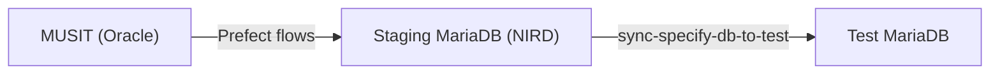

# Architecture

This section describes the high-level architecture of the migration process.

## Data Flow Overview

The migration loads MUSIT Oracle into Specify on NIRD, then can copy that database onto the test instance.

### Components

1.  **Source**: MUSIT Oracle. Reachable from the cluster; from a laptop, via `scripts/port-forward.sh`.
2.  **Migration logic**: Prefect flows on the NIRD `prefect-dev-worker`. They use the Specify 7 Django ORM.
3.  **Staging**: Helm release `specify7` in namespace `unimus-ns12130k` (context `nird`). App at `https://specify-stg.natur.unimus.no/`. MariaDB, Redis, asset server, report runner, and Prefect share that release. See [Kubernetes Deployment](kubernetes_deployment.md).
4.  **Test**: `https://specify-test.natur.unimus.no/` is not managed by this chart. `sync-specify-db-to-test-dev` streams a logical dump of staging MariaDB through an SSH LocalForward on the dev worker. It does not copy S3 attachments.
